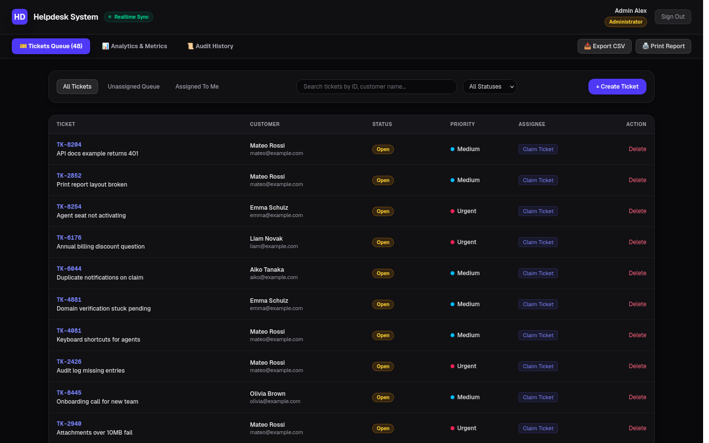
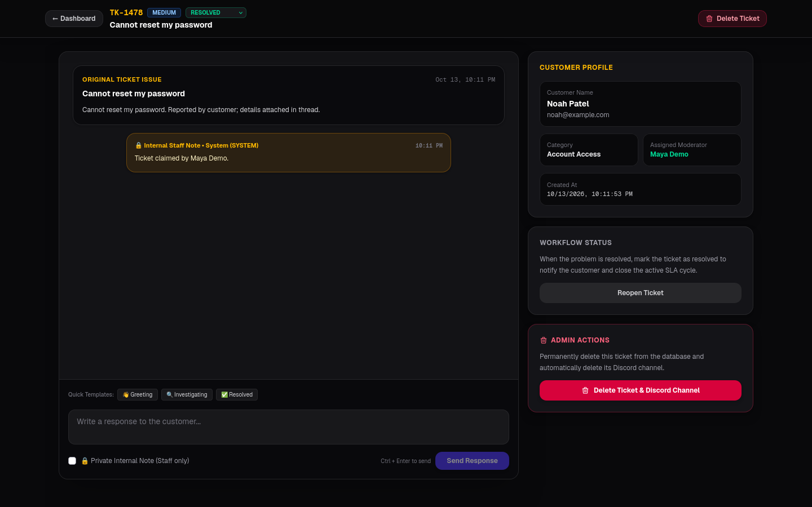
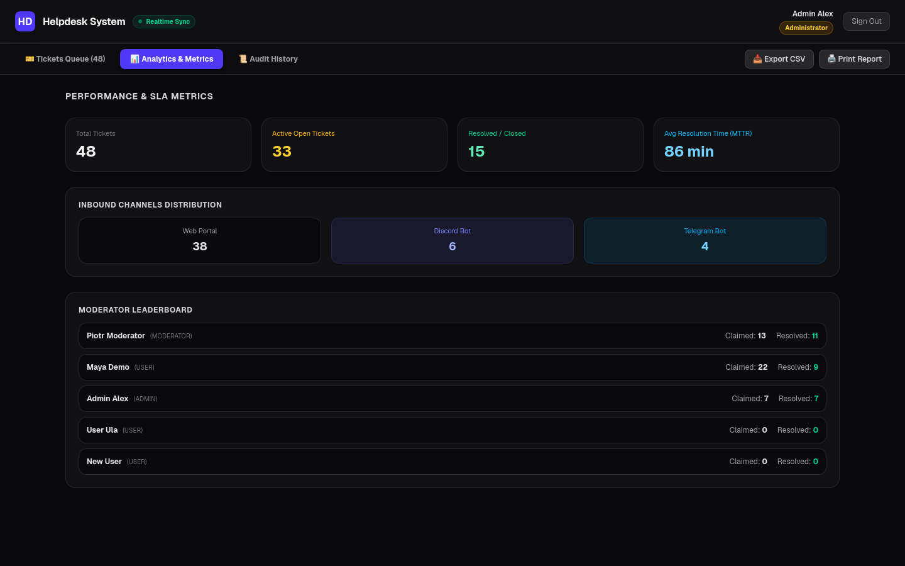
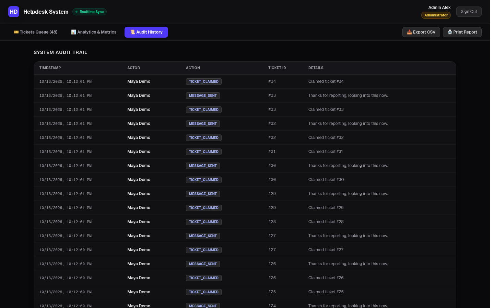
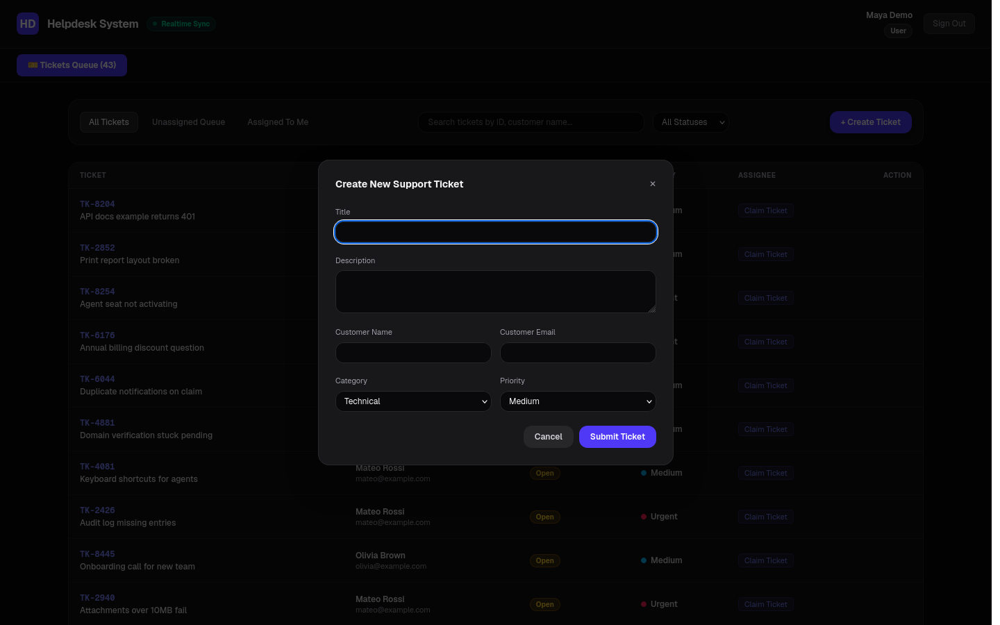
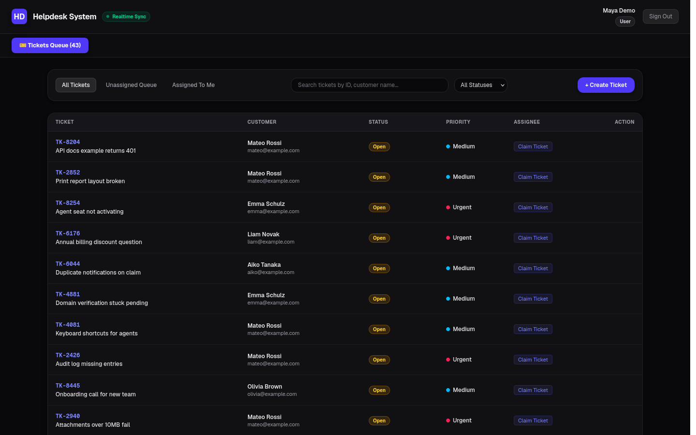
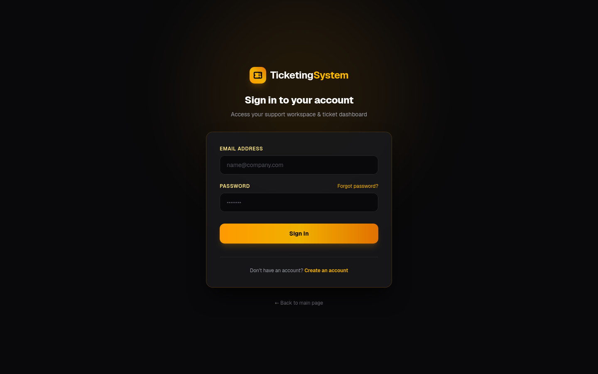
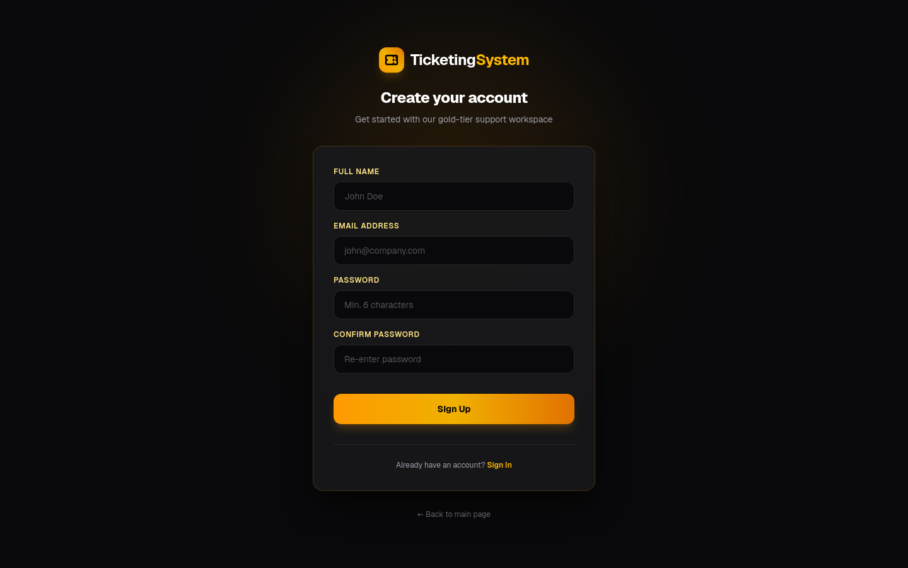

<div align="center">

# 🎫 TicketingHQ

**A full-stack, multi-channel help desk ticketing system for web, Discord, and Telegram.**

Create, triage, claim, resolve, and audit support tickets from a single dashboard — with real-time
sync across channels and a built-in Discord + Telegram bot daemon.

[](https://nextjs.org)
[](https://react.dev)
[](https://www.typescriptlang.org)
[](https://www.mongodb.com)
[](https://discord.js.org)
[](https://core.telegram.org/bots/api)
[](#-license)

</div>

---

## 📖 Overview

TicketingHQ is a help desk platform where support tickets can arrive from **three channels**:

- 🌐 **Web** — customers submit tickets and staff manage them from the dashboard.
- 💬 **Discord** — a bot provisions a private thread/channel per ticket and relays messages both ways.
- ✈️ **Telegram** — a long-polling bot lets users open and reply to tickets directly in chat.

All channels converge on one MongoDB-backed queue with roles, claims, priorities, internal notes,
audit logging, and analytics — all updated live via Server-Sent Events (SSE).

---

## 📸 Screenshots

<table>
  <tr>
    <td width="50%"><p align="center"><b>Ticket queue</b> — status badges, priority dots, one-click claim</p></td>
    <td width="50%"><p align="center"><b>Ticket detail</b> — conversation thread, internal notes, workflow</p></td>
  </tr>
  <tr>
    <td><p align="center"><b>Analytics</b> — SLA metrics, channel split, leaderboard</p></td>
    <td><p align="center"><b>Audit trail</b> — every claim, reply and status change</p></td>
  </tr>
  <tr>
    <td><p align="center"><b>Create ticket</b> — category and priority up front</p></td>
    <td><p align="center"><b>User view</b> — only the open pool and your own claims</p></td>
  </tr>
  <tr>
    <td><p align="center"><b>Sign in</b></p></td>
    <td><p align="center"><b>Sign up</b></p></td>
  </tr>
</table>

---

## ✨ Features

- 🎫 **Ticket lifecycle** — `OPEN → IN_PROGRESS → RESOLVED → CLOSED` with priorities, categories,
  and assignment.
- 👥 **Role-based access** — three escalating staff roles (`User`, `Moderator`, `Administrator`)
  enforced on every API route. See [Roles & Permissions](#-roles--permissions).
- 💬 **Bi-directional messaging** — customer replies from Discord/Telegram appear in the dashboard
  and vice-versa.
- 🧵 **Discord integration** — slash-command ticket panel, auto-provisioned channels, claim/resolve
  flows, and permission cleanup.
- ✈️ **Telegram integration** — `/start`, `/ticket [subject]`, and `/close` commands via long
  polling (no public URL or webhook needed).
- ⚡ **Real-time updates** — an SSE bus (`/api/events`) pushes ticket and message changes to every
  open dashboard.
- 📊 **Analytics** — totals, open/resolved counts, MTTR, per-channel breakdown, and top moderators.
- 🧾 **Audit log** — every significant action is recorded with actor, action, and timestamp.
- 🔐 **Auth** — email + password accounts with bcrypt hashing and signed session cookies.

---

## 👥 Roles & Permissions

Every API route re-reads the current user's role from MongoDB and blocks anything the session
doesn't allow (partial/stale sessions cached in the browser are ignored).

| Capability | `USER` | `MODERATOR` | `ADMINISTRATOR` |
| --- | :---: | :---: | :---: |
| View **unclaimed** ticket pool | ✅ | ✅ | ✅ |
| Claim tickets | ✅ | ✅ | ✅ |
| Respond to own claimed tickets | ✅ | ✅ | ✅ |
| Respond to tickets **without** claiming | — | ✅ | ✅ |
| See **all** tickets (incl. others' assignments) | — | ✅ | ✅ |
| Update any ticket status | — | ✅ | ✅ |
| Delete tickets | — | — | ✅ |
| Analytics & metrics | — | — | ✅ |
| Audit history | — | — | ✅ |
| Print / CSV reports | — | — | ✅ |

**Key rules:**

- A `User` can only see the **unclaimed pool** plus tickets they personally claimed — other
  agents' assignments and closed tickets are never exposed. They must **claim** a ticket before
  they can respond, and may only change the status of their own claimed tickets.
- A `Moderator` sees everything, may claim, and may respond to a ticket **without** claiming it.
- An `Administrator` can do all of the above and additionally owns the destructive/management
  capabilities: **ticket deletion**, **analytics**, and the **audit log**.
- **Self-registration always grants `USER`** — `MODERATOR` and `ADMIN` can only be granted
  manually (via the seed script or a direct database edit). This prevents privilege escalation
  through the public sign-up page.

> Demo accounts (created by `npm run seed`):
> | Email | Password | Role |
> | --- | --- | --- |
> | `admin@helpdesk.com` | `password123` | Administrator |
> | `mod@helpdesk.com` | `password123` | Moderator |
> | `user@helpdesk.com` | `password123` | User |

---

## 🏗️ Architecture

```
                    ┌─────────────────────────────┐
                    │   Browser (Next.js App)     │
                    │  Landing • Dashboard • SSE  │
                    └──────────────┬──────────────┘
                                   │  REST + EventSource
                                   ▼
        ┌──────────────────────────────────────────────┐
        │          Next.js API Routes (/api/*)          │
        │  auth • tickets • responses • analytics • ... │
        └───────┬───────────────────────────┬──────────┘
                │                           │
                │ MongoClient               │ POST /bot/*  (HTTP bridge :3001)
                ▼                           ▼
        ┌───────────────┐          ┌────────────────────────────┐
        │   MongoDB     │◄─────────┤   Bot Daemon (Node.js)     │
        │  users        │  shared  │  discord.js  +  Telegram   │
        │  tickets      │  driver  │  long polling              │
        │  messages     │          └───────────┬────────────────┘
        │  audit_logs   │                      │
        └───────────────┘             Discord Gateway / Telegram API
```

The Next.js server and the bot daemon are **separate processes** that share the same MongoDB
database through `lib/mongo.js`. The dashboard talks to the bot through a small local HTTP bridge
on `BOT_PORT`.

---

## 🚀 Quick Start

### Prerequisites

| Requirement | Notes |
| --- | --- |
| **Node.js 20+** | Next.js 16 requires Node 20 or newer. |
| **MongoDB 6+** | Local `mongod` on `localhost:27017`, or any reachable instance / Atlas URI. |
| **Git** | To clone the repository. |

> Discord and Telegram tokens are **optional**. The web dashboard works fully without them.

### 1. Clone and install

```bash
git clone <your-repo-url> HelpDeskTicketingSystem
cd HelpDeskTicketingSystem
npm install
```

### 2. Create your environment file

Copy the template and generate a session secret (the only required value):

```bash
cp .env.example .env.local
sed -i "s/^SESSION_SECRET=.*/SESSION_SECRET=$(openssl rand -hex 32)/" .env.local
```

Every other variable in [`.env.example`](.env.example) is optional and documented inline.

> ⚠️ **The app will not boot without `SESSION_SECRET`.** Generate one with
> `openssl rand -hex 32` and paste the value in.

### 3. Seed sample data (one-time)

```bash
npm run seed
```

This creates the documented demo accounts and a couple of sample tickets:

| Email | Password | Role |
| --- | --- | --- |
| `admin@helpdesk.com` | `password123` | Administrator |
| `mod@helpdesk.com` | `password123` | Moderator |
| `user@helpdesk.com` | `password123` | User |

### 4. Run it

**Option A — one command (recommended):**

```bash
./start.sh
```

This boots MongoDB (if `mongod` is installed and nothing is already listening), the Next.js dev
server, and the bot daemon together, then tears everything down cleanly on `Ctrl+C`.

**Option B — run services manually (three terminals):**

```bash
# Terminal 1 — database (skip if MongoDB is already running)
mongod --dbpath ./.data/mongodb

# Terminal 2 — web app
npm run dev

# Terminal 3 — bot daemon (Discord + Telegram + HTTP bridge)
node bot/index.js
```

Open **http://localhost:3000** and sign in with a seeded account.

---

## 🔌 Integrating the Bots (optional)

Both integrations are enabled automatically when their token is present in `.env.local`.

### Discord

1. Go to the [Discord Developer Portal](https://discord.com/developers/applications) and create an
   application, then a **Bot**.
2. Enable the **Message Content** and **Server Members** privileged intents.
3. Copy the bot token into `DISCORD_BOT_TOKEN`.
4. Invite the bot with permissions to **Manage Channels**, **Send Messages**, and
   **Read Message History**.
5. In your server, run the slash command `/set #channel` to post the ticket panel.

### Telegram

1. Message [@BotFather](https://t.me/BotFather), create a bot, and copy the token into
   `TELEGRAM_BOT_TOKEN`.
2. Users interact via:
   - `/start` — show help,
   - `/ticket [subject]` — open a new ticket,
   - `/close` — close the active ticket.

No webhook or public domain is required; the bot uses long polling.

---

## ⚙️ Environment Variables

| Variable | Required | Default | Description |
| --- | :---: | --- | --- |
| `SESSION_SECRET` | ✅ | — | 32+ char secret for signing session cookies. |
| `MONGODB_URI` | | `mongodb://localhost/helpdesk_db` | Full connection string. Overrides `DB_HOST`/`DB_NAME`. |
| `DB_HOST` | | `localhost` | Mongo host used when `MONGODB_URI` is unset. |
| `DB_NAME` | | `helpdesk_db` | Mongo database used when `MONGODB_URI` is unset. |
| `DISCORD_BOT_TOKEN` | | — | Enables the Discord integration. |
| `TELEGRAM_BOT_TOKEN` | | — | Enables the Telegram integration. |
| `BOT_PORT` | | `3001` | Port of the local bot HTTP bridge. |
| `BASE_URL` | | `http://localhost:3000` | Base URL used by the smoke tests. |

---

## 📜 npm Scripts

| Command | Description |
| --- | --- |
| `npm run dev` | Start the Next.js dev server (Turbopack). |
| `npm run build` | Create a production build. |
| `npm start` | Run the production server. |
| `npm run seed` | Seed demo users and sample tickets. |
| `npm run smoke` | Run 27 end-to-end checks against a running app + MongoDB. |
| `npm run lint` | Run ESLint. |

---

## 🧪 Testing

With the app running on `localhost:3000` and a reachable MongoDB:

```bash
npm run smoke
```

The smoke suite exercises auth, ticket CRUD, claiming, responses, analytics, audit logs, and
cascading deletes end-to-end. Set `BASE_URL` to point it at a different host/port.

---

## 📁 Project Structure

```
HelpDeskTicketingSystem/
├── app/
│   ├── page.tsx                     # Marketing / landing page
│   ├── login/ • signup/             # Auth pages
│   ├── dashboard/
│   │   ├── page.tsx                 # Ticket queue, filters, analytics
│   │   ├── report/page.tsx          # Reporting view
│   │   └── tickets/[id]/page.tsx    # Ticket detail + conversation
│   └── api/                         # REST API routes
│       ├── auth/                    # login • logout • me • register
│       ├── tickets/                 # list/create • update/delete • claim • responses
│       ├── analytics/               # dashboard metrics
│       ├── audit-logs/              # audit trail
│       └── events/                  # SSE event bus
├── bot/
│   ├── index.js                     # Discord bot + HTTP bridge
│   └── telegram.js                  # Telegram long-polling bot
├── lib/
│   ├── mongo.js                     # Shared MongoDB driver + auto-increment ids
│   ├── db.ts                        # Typed collection wrappers
│   ├── auth.ts / auth-server.ts     # Session helpers
│   └── audit-log.ts                 # Audit event recorder
├── seed.js                          # Demo data seeder
├── smoke.js                         # End-to-end smoke tests
├── start.sh                         # One-command dev launcher
├── .env.example                     # Template for .env.local
└── .env.local                       # Your local secrets (gitignored)
```

---

## 🔒 Security Notes

- Never commit `.env` / `.env.local` — they are gitignored.
- Always set a strong, unique `SESSION_SECRET`; rotating it invalidates existing sessions.
- Passwords are hashed with bcrypt (cost 12) and never returned by the API.

---

## 📄 License

**Copyright © 2026 Piotr Kapeluszny. All Rights Reserved.**

This is a **personal portfolio application** and is **not open source**. The source is made
public solely so prospective employers and recruiters can review the author's work when
evaluating him as a candidate (including for the purpose of a job offer).

You do **not** have consent to modify, distribute, copy, host, or reuse this project, in whole
or in part, for any other purpose. See the full [LICENSE](./LICENSE) for the complete terms.
